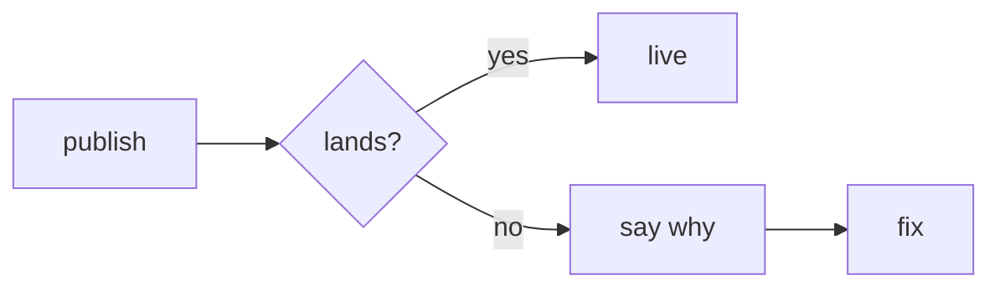
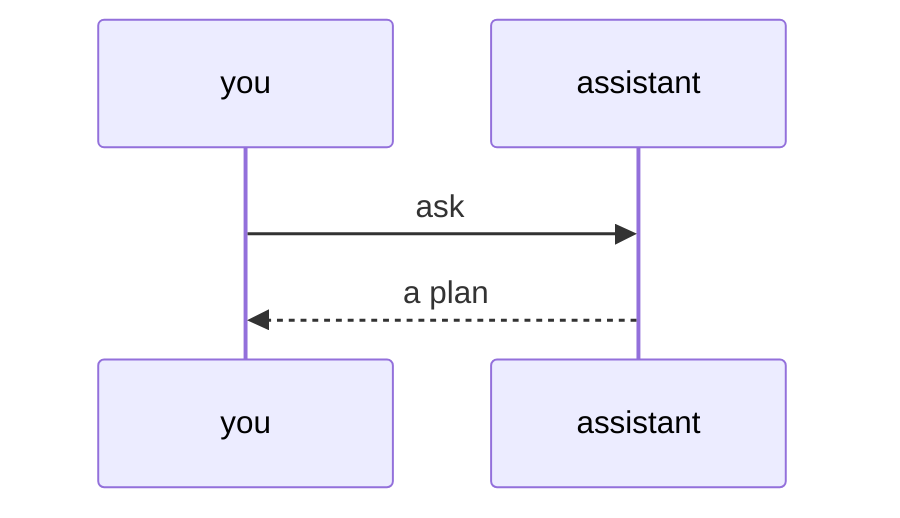
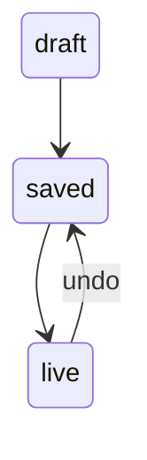

# Drawing in plans and explore

How [`/plan`](../SKILL.md#draw-in-the-proposal-then-build-the-page) and [`/explore`](../../explore/SKILL.md#questions-during-standalone-exploration) draw. Pick the pattern by what the bullet explains, not a top-to-bottom chain.

- **A flow is a `mermaid` fence**: steps, a back-and-forth, or states, drawn as a picture. Keep labels few and short: the builder warns past 640 px. Quote `"/apply"`: bare `[/apply]` is a shape.
- **A screen or table is a `text` fence** in line characters as below, no emoji (two columns wide). Aim for 40 columns; up to 56 side by side; the builder warns past 60. Pad every box line to its top edge's length: the builder flags a crooked edge.

**Steps**: usual path in one line, failures below.


**Back and forth**: who asks whom, in order.


**States**: where a thing stands, what moves it.


**Side by side, labels under**
```text
┌────────┐  ┌────────┐
│ manual │  │  auto  │
└────────┘  └────────┘
 slow, safe  fast, risky
```

**Comparison table**
```text
        │ local │ sync
────────┼───────┼───────
login   │ none  │ needed
offline │ yes   │ cached
```

**Before and after**: a changed flow or screen, `+` on new parts. Screens: low fidelity, a new one per named state ([what it holds](../../../../wiki/ux-principles.md#the-review-file)).
```text
  BEFORE         AFTER
save ─▶ live   save ─▶ +check ─▶ live
┌─────────┐    ┌─────────┐
│ Notes   │    │ Notes 3 │
│ [Copy]  │    │ +[Save] │
└─────────┘    └─────────┘
```
