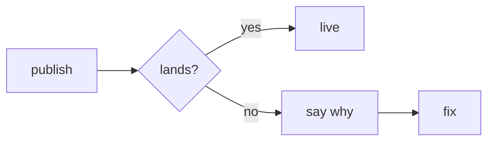

# Drawing in plans and explore

How [`/plan`](../SKILL.md#draw-in-the-proposal-then-build-the-page) and [`/explore`](../../explore/SKILL.md#questions-during-standalone-exploration) draw: pick by what the bullet explains.

- **A flow is a `mermaid` fence**: steps, states, or a back-and-forth (`sequenceDiagram`). Keep labels short: the builder warns past 640 px. Quote `"/apply"`: bare `[/apply]` is a shape.
- **A screen is a `screen` fence**, HTML in the app's parts with real words: `card`, `btn-primary`, `btn-ghost`, `field`, `tag`, `tag-outline`, `skeleton`; layout `row`, `col`, `gap`, `grow`, `phone` (360 px), `muted`, `danger`, `bar` (unknown text), `sep`. No style, id, link, or image: the build stops. Sketch each named state ([what it holds](../../../../wiki/ux-principles.md#the-review-file)).
- **A screenshot is a `picture` fence** of `[label:] path` lines: `Before: pictures/a.png`; a prototype adds `After:` and `Try it: <https url>`.
- **An ad is an `ad` fence**: `placement: feed|story`, `account:`, `picture:`, `text:`, `headline:`, `button:`.
- **Arrows or layers are an `svg` fence**, painted only `bg`, `fg`, `muted`, `subtle`, `line`, `card`, `danger`.
- **A table is a Markdown table** under its bullet; each row takes a note.
- **Chat and file lists stay a `text` fence**: chat shows no pictures.

**Steps**: usual path in one line, failures below.


**Screen**
```screen
<div class="card col gap phone">
  <div class="row gap"><h3>Notes</h3><span class="tag">3</span></div>
  <div class="bar"></div>
  <input placeholder="A question or a change">
  <div class="row gap"><span class="grow"/>
    <button class="btn-ghost">Cancel</button><button class="btn-primary">Save</button></div>
</div>
```
