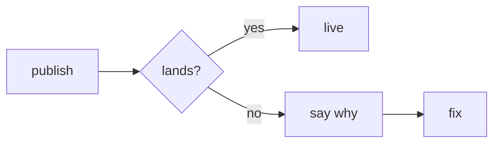
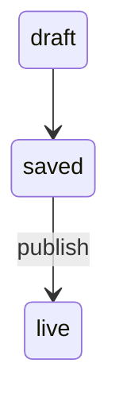

# Drawing in plans and explore

How [`/plan`](../SKILL.md#draw-in-the-proposal-then-build-the-page) and [`/explore`](../../explore/SKILL.md#questions-during-standalone-exploration) draw. Pick the pattern by what the bullet explains.

- **A flow is a `mermaid` fence**: steps, states, or a back-and-forth (`sequenceDiagram`). Keep labels few and short: the builder warns past 640 px. Quote `"/apply"`: bare `[/apply]` is a shape.
- **A screen is an `svg` fence**: a gray wireframe on an 8 px grid, under 640 wide. Paint only with `bg`, `fg`, `muted`, `subtle`, `line`, `card`, `danger`; labels go in `<text>`. No style, link, or image: the build stops. Before and after sit side by side, `+` on new parts; sketch each named state ([what it holds](../../../../wiki/ux-principles.md#the-review-file)).
- **A table is a Markdown table** in the bullet; each row takes a note.
- **Chat and file lists stay a `text` fence**, about 40 columns: chat shows no pictures.

**Steps**: usual path in one line, failures below.


**States**: where a thing stands, what moves it.


**Screen**
```svg
<svg viewBox="0 0 240 128">
  <rect width="240" height="128" rx="8" fill="card" stroke="line"/>
  <text x="16" y="28" font-weight="600">Notes 3</text>
  <rect x="16" y="44" width="208" height="32" fill="muted"/>
  <rect x="16" y="88" width="72" height="28" rx="14" fill="fg"/>
  <text x="52" y="106" text-anchor="middle" fill="bg">Save</text>
</svg>
```

**Table**
```markdown
| | local | sync |
|-|-|-|
| login | none | needed |
```

**Chat or a file list**
```text
plan/
├─ proposal.md
└─ review.html
```
