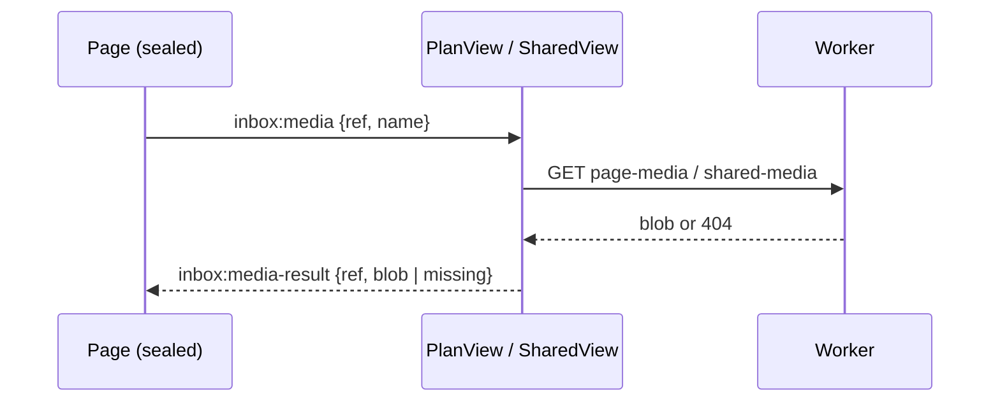

# Design

## Context

- Port of ClaymooApp's `ad-review-in-inbox` design D1 (page HTML out of the row) and D2 (media handed in over the port); its D3–D5 (ad review, Graveyard names, ad docs) stay there.
- WongStack keeps a page's HTML in `inbox_items.body`. `item-put.ts` refuses a body over `LIMITS.bodyBytes` (1.6 MB) and takes 3 MB of JSON. `page.mjs` stops at 1.5 MB.
- A review page shows by `srcDoc` from `GET item` (`PlanView.tsx` `PageFrame body=`), and the client reads three things from that body in `frame.ts`: `notesKey` (`<body data-change>`), `ownBack` (`<body data-own-back>`) and `actionLabels` (`#ready data-actions`). A plain page shows by `src` from `GET frame` (`share.ts`, `sealedPage`); a team link by `GET shared-frame`. The sealed CSP already allows `img-src data: blob:; media-src data: blob:` and keeps `connect-src 'none'`.
- Page files (#621) live in D1, not a bucket: `inbox_page_files` names them, `inbox_page_file_parts` holds 512 KB parts, 5 a page, 25 MB each, 1 GB for the app (`PAGE_FILES`). The reason, in [`plain-pages.md`](../../../wiki/development/plain-pages.md#why-and-edge-cases): the only bucket is memory's, production-only, and optional.
- The memory bucket is optional because an account can have R2 off: `provision.mjs` makes it only when `r2Buckets` answers, and `wranglerConfig` drops its lines otherwise.
- `lib/bridge.js` (relative `alive`, `send`, `act` over the inbox's port) and the inbox-only `openLink` arrive with PR #619 (`reply-links-skip-the-tunnel`), which raises `PROTOCOL` to 17. ClaymooApp's is 20, 21 after its own change.

## Goals / Non-Goals

**Goals:** any inbox page up to 25 MB; pictures and videos inside any page, from the inbox and from a team link; a reply-link page asks for media by name and sends files with `send`; every older page opens as it did; an install with R2 off keeps working.

**Non-goals:** moving page files to the bucket; media for `page.mjs` plain pages; a new screen; ClaymooApp's ad review.

## Decisions

### D1. One page store: the bucket when bound, else database parts

- New binding `INBOX_PAGES` (R2), bucket `<base>-inbox` in production, `<base>-inbox-staging` in staging (a twin, by [staging bindings](../../../wiki/stack/staging-bindings.md#twin-every-stateful-binding)), and a local one in `env.local`. Optional in `worker-configuration.d.ts`, as `MEMORY_BUCKET` is.
- New `app/worker/apps/inbox/page-store.ts` owns the bytes of a page's body and media: `put(at, item, sha256, name, stream)`, `read(at, item, sha256)`, `drop(at, keys)`. With `INBOX_PAGES` bound, it streams to `inbox/<installation>/<email sha256>/<item>/<sha256>` (R2 checks the hash with `put`'s `sha256` option, and the size limit is checked as it streams); without it, it writes the same `inbox_page_file_parts` parts page files use (`storeUpload`, moved here), under the 1 GB cap.
- Each stored blob is a row in `inbox_page_files` with a new `role` (`file`, `media`, `body`) and `stored` (`db`, `bucket`). `filesOfPage` and the download routes read only `role = 'file'`, so a download list never shows media or the page.
- Page files keep `stored = 'db'` always: the person chose not to move them.
- *Alternative:* a `body_key` column, as ClaymooApp has. Rejected: the files table already names a page's blobs by item and hash, and its prune and drop already run; one more role is less code than a second naming scheme.

### D2. Page HTML out of the row

- New route `PUT page-body?id=&sha256=` beside `PUT page-file`, with its checks (a person's sign-in, same origin, an item id, `plan` kind or none yet). At most 25 MB (`PAGE_BODY_BYTES`), stored by D1's `page-store`. `PUT page-file` now also takes a review page (not only `plain`) for `media`.
- `PUT item` for `kind: plan` takes `bodySha256` in place of `body`. It checks the blob is stored whole, writes the `body` role row, sets `inbox_items.body = ''`, and reads the stored HTML once to fill a new `page_info` JSON column: `{ key, ownBack, labels }`. The `notesKey`, `ownBack` and `actionLabels` parsers move from `app/src/apps/inbox/frame.ts` to `app/worker/apps/inbox/page-info.ts`; the client keeps none.
- `PUT item` still takes `body` up to 1.6 MB for one release, for a computer between updates. Other kinds keep their small `body` in the row.
- `GET frame` and `GET shared-frame` stream the `body` role blob when there is one, else `inbox_items.body`. `sealedPage` takes a stream; a plain page's `<base>` is still added (`linksOpenOwnTab`) on the head chunk.
- `GET item` stops returning `body`; it returns `page: { key, ownBack, labels }` from `page_info`, or parsed from the row's `body` for an older row. `PlanView` shows every page by `src` and greets the frame on load as now; the port stays tied to the version.
- The `version` stays the page's hash; a new version replaces the `body` row, and the old blob goes with the unnamed-upload prune.

### D3. Media handed into the frame

- `PUT item` takes `media: [{ name, size, sha256 }]` on any `plan` item: up to 300, pictures and videos only (`png jpg jpeg webp gif mp4 webm mov`, checked by first bytes with `startsAsNamed`), 95 MB each with the bucket, `PAGE_FILES.file` (25 MB) without. Uploads use `PUT page-file?…&media=1`. Putting the page again replaces its media rows.
- New `GET page-media?id=&name=` (owner) and `GET shared-media?token=&name=` (open team link, 404 once stopped): the blob with its type, `nosniff`, `Content-Security-Policy: sandbox`, `private, no-store`; never `attachment`, because it becomes a Blob, not a download.
- The page posts `inbox:media { ref, name }` on its port. `frame.ts` adds the message; `PlanView` and `SharedView` fetch the route and answer `inbox:media-result { ref, blob }`, or `{ ref, missing: true }` on a 404. The page shows it with `URL.createObjectURL`.
- A team link's frame has no port today: `SharedView` hands one over on load, answering only `inbox:media`; a tap or a note through it is dropped.

### D4. The reply-link side

- `lib/inbox.mjs` gets one `putPage(client, item, html, { files, media })`: upload the HTML with `PUT page-body`, each file and media with `PUT page-file`, then `PUT item` with `bodySha256`. `reply-link.mjs` (`openInboxItem`, `openReviewLink`) and `page.mjs` use it; nothing else puts a page's body.
- `reply-link.mjs open <page> --media <json>`: a list of `{ name, path }`; each file is hashed, checked by kind and size on the computer first, then uploaded. Signed out → nothing uploads, `REPLY_REASON=signed-out` as today.
- `lib/bridge.js`: `window.replyMedia(name) → Promise<Blob|null>` over the port; `send(text, files?)` sends each `File` or `Blob` as `inbox:file` (named, 25 MB each, as the review kit does), then the tap with `files`.
- `PROTOCOL` 17 → 18 in `reply-link.mjs` and `helper.mjs`'s `PROJECT_PROTOCOL`, so a running helper that puts `body` is replaced at the next open.
- `page.mjs`: the stop goes from 1.5 MB to 25 MB; the 800 KB phone warning stays.

### D5. Provisioning and the update

- `provision.mjs` adds `{ kind: 'bucket', name: n.inbox }` and `n.inboxStaging` when R2 is on, and `wranglerConfig` keeps or drops the `INBOX_PAGES` lines as it does the memory bucket's. `cf-secrets.mjs`'s binding parity check knows the new binding is optional.
- This repo: `/apply` makes `wongstack-inbox` and `wongstack-inbox-staging` with the `.env` Cloudflare key before the first deploy.
- `CHANGELOG.md` minor entry. **Updating.**: the sync makes the two file stores for the inbox in Cloudflare (when file storage is on) and adds them to the app's settings; with it off, pages still work and pictures stay 25 MB each.

### D6. Docs

- [`plain-pages.md`](../../../wiki/development/plain-pages.md): *Size* 25 MB; a page's media; *Why the database, not a bucket* rewritten: page HTML and media in the inbox bucket, page files still in the database, and the fallback.
- The reply-link pages doc #619 adds: `replyMedia`, files with `send`, `--media`.
- [`review-pages.md`](../../../wiki/review-pages.md): the size line.

## Risks / Trade-offs

- [A 95 MB video moves through the browser as one Blob] → the page asks when a tile nears the screen; the docs say so.
- [`GET item` without the body breaks an older client tab] → client and server ship together; an old tab reloads on its next version check.
- [The fallback holds media in D1] → 25 MB each and the 1 GB cap; the message names the limit.
- [A rollback] → pages put with `bodySha256` have `body = ''`; keep the read path for one release after any rollback.
- [Two changes on `reply-link.mjs`] → built on top of #619 after it ships, not beside it.

## Migration Plan

1. `npm run db:new-migration -- inbox_page_store` (timestamped in `schema/migrations/`): `ALTER TABLE inbox_items ADD COLUMN page_info TEXT`; `ALTER TABLE inbox_page_files ADD COLUMN role TEXT NOT NULL DEFAULT 'file'`; `ADD COLUMN stored TEXT NOT NULL DEFAULT 'db'`. Old rows keep `body` and are page files.
2. Buckets exist before the deploy that binds them.
3. Server and client ship together; the raised `PROTOCOL` replaces an older helper.

## Checks after the merge

- On the live app, `reply-link.mjs open` a demo page with two pictures and a short video; it opens from the inbox with each shown and the video playing, and its team link shows them too.
