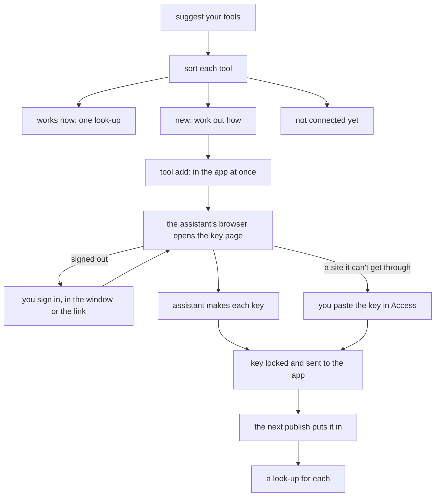

# Connect your tools

Connecting your tools lets your assistant use the services you work with, such as Stripe, Notion or Figma, through your company app. Setup starts it right after install. Later, say *connect my tools*, or name one tool: *connect my Figma*. The [`connect` skill](../../.agents/skills/connect/SKILL.md) follows this page.



## The three groups

Each tool goes in one group:

- **Works now.** The app can already use it. One look-up shows it working.
- **Waiting.** The app does not know it yet, its key is not saved, its key waits for the next publish, or you have no level for it. For the owner or an Admin, the helper adds it ([add a new tool](#add-a-new-tool-with-no-publish)). For a teammate, it writes [a message for the owner](#a-teammates-computer).
- **Not connected yet.** A website with no API, a tool that offers only a sign-in, or your own mail, such as Gmail. You keep using it yourself. The helper signs in to no such site and sends no live view.

It ends with a short list:

```text
Your tools
  ✓ Stripe     works: 3 charges today
  … Shopify    key sent, ends in …9f2c: goes live at the next publish
  … Notion     waiting for your key
  – Gmail      not connected yet: it needs a sign-in, which the app can't keep yet
```

After install, setup then offers a first app built on the tools that work ([getting started](getting-started.md#what-youll-end-up-with)). Later, the list is the whole answer.

## Sort each tool

1. **Suggest the tools they use.** With no tool named, read the person's page in `people/` and search memory: `node .claude/skills/memory/scripts/memory.mjs search <tool words>`, over what [setup learned from past chats](learning-from-chats.md). Say *You seem to use Stripe, Notion and Figma. Connect these?*, and let them confirm or change the list. With nothing known, ask which tools they use. When the person names one tool, handle that tool only, and ask about no other.
2. **Read the services list once:** `node scripts/company-api.mjs services --all --json` ([the services list](service-catalogue.md#list-the-services-you-can-use)). Match each tool to a row by name or id. When two rows could match, ask once.
3. **Find if this person can send keys.** The owner and [an Admin](employee-access.md#admin) can, from any computer they are signed in to the company app on: no Cloudflare login is needed. Anyone else takes [the teammate path](#a-teammates-computer).

| `services` says | Owner or Admin | Teammate |
|---|---|---|
| Saved, you have a level | Works now: one look-up | Works now: one look-up |
| In the list, not saved | [A browser](#pick-the-browser) and `take-key`, else [paste it in Access](#paste-a-key-in-access) | Message: *save the key* |
| Saved, you have no level | Does not happen: the owner holds every key | Message: *give me a level on Access* |
| No row | [Work out how](#work-out-how-to-add-a-new-tool), then [add it](#add-a-new-tool-with-no-publish) | Message: *connect <tool> for <name>* |
| No row, and no API at all | Not connected yet | Not connected yet |

Whether a tool has a public API comes from its own developer pages.

**A look-up** is one request that changes nothing: a read action, or a `GET` from the tool's [notes page](service-catalogue.md#notes-on-each-key-based-service) or its API guide, sent through `company-api.mjs` ([use a key directly](company-api.md#use-a-key-directly)). Show one short result, such as *3 charges today*. When you know no look-up, the line says only *ready*.

## Work out how to add a new tool

Most tools are new to the app, so this is the main step. For each tool with no row, start from its notes page, `wiki/services/<id>.md`, when one exists. Otherwise read the tool's own developer pages as plain pages. Pick the first way that fits:

| The tool offers | The app gets | Example |
|---|---|---|
| A fixed API key or personal access token | [A key used directly](company-api.md#use-a-key-directly): `forward`, `docs`, `lookups` | Stripe restricted key, Figma personal token |
| An ID and a secret that trade for a short token (the client-credentials grant) | The same, with `forward.exchange`: [an ID and a secret](#a-tool-with-an-id-and-a-secret) | Shopify's Dev Dashboard app |
| A remote MCP server that takes a fixed key | [An MCP server through the app](company-api.md#use-an-mcp-server-through-the-app): `forward.mcp`, with `reads` checked by hand | a server with a bearer key |
| Only a sign-in that renews (OAuth) | Nothing yet: *not connected yet: it needs a sign-in, which the app can't keep yet* | Google mail and calendar |

Write what you found on the tool's notes page: the kind of key, the page that makes it, the permissions, and one look-up. It goes in the next wiki save, like [any notes page](service-catalogue.md#notes-on-each-key-based-service). The next chat then reads it, and does not work it out again.

## Pick the browser

The assistant makes each new tool's key in its own browser, Camoufox, on every computer, through [`browser.mjs`](../../.agents/skills/connect/scripts/browser.mjs) only: never raw `agent-browser` or `browse.mjs`. Run `browser.mjs where` first. It connects to nothing and prints one line:

- `WHERE=window`: a Mac or Windows computer. The browser shows in its own window, the one used for robot checks. [Use the assistant's browser](#use-the-assistants-browser), with no question.
- `WHERE=server`: a server with no screen. Use the same browser, with the [watch link](../development/watch-link.md) for a sign-in.
- `WHERE=link`: no browser can show here. The person [pastes each key in Access](#paste-a-key-in-access).

The request to connect is the go-ahead: ask nothing first. Pasting in Access is always the last way, for a tool the browser can't get through.

## Use the assistant's browser

The assistant starts at once. Sign-ins stay in its browser for the next time. On a server, it sends the watch link only when a tool asks the person to sign in, or when the person asks to watch; while a link is open, the person can take over or hand back. On a Mac or Windows computer, the window is already in view. To stop, the person says so in the chat.

1. **`attach`** prints `BROWSER=camoufox`. On `BROWSE_NEEDS=install`, ask once, by [the browser's install rule](../development/browsing.md).
2. **`open <key page>`** for the first tool. Only when the person asks to watch, run **`watch`**: on a server it prints `HANDOVER_LINK`, so send the link and go on; in a window it prints `HANDOVER_VIEW=window` and opens nothing.
3. **`read`**, then **make the narrowest key that only reads**, with `click`, `fill`, `select` and `wait`. Make a key that can change things only when the person asks for it by name. `read` hides any key on the page as `[key …abcd]`, and `picture` refuses while a key shows. While a link is open, each command sets its line, such as *Clicking New integration…*.
4. **Signed out?** Run **`sign-in --tool <title>`** on the sign-in page. It prints `CONNECT_PAUSED=your-turn`:
   - **In a window** it prints `HANDOVER_VIEW=window` first. End the turn with *Sign in to Shopify in the browser window, then say done.* Run `hand-over.mjs wait` in the background. The turn ends by itself once the key page shows, or on the person's *done*: then run `hand-over.mjs close`.
   - **On a server** it opens the watch link first and prints `HANDOVER_LINK`. Run `hand-over.mjs wait` in the background and end the turn with the link. On `opened`, `wait` again.

   On `signed-in`, `handed-back` or *done*, `open` the key page again and `read`. Never type, save, or ask for a password or a sign-in code. Still a sign-in, a passkey, or a refusal: list that tool to [paste in Access](#paste-a-key-in-access) at the end.
5. **`take-key [<ref>] --tool <id>`** takes the key from the page, [seals it and sends it to the app](#how-a-key-reaches-the-app), and prints only `TOOL_<ID> sent, ends in …abcd, goes live at the next publish`. Add `--id` to send a tool's ID as `TOOL_<ID>_ID`. It also saves the key in the primary `app/.dev.vars`, for local runs. A key in the code has its own name, so the person [pastes it in Access](#paste-a-key-in-access).
6. **`done`** closes the page and any open link. The link says *All done. Go back to the chat.* When the person says *stop* in the chat, run `done --stopped`: the link says *Stopped*. Keys sent stay sent.

When `watch` or `sign-in` prints `HANDOVER_NEEDS=live-view`, or another chat's view is open, follow the [live view's rules](../development/live-view.md#when-it-opens).

Every command reads who holds the browser first:

- `CONNECT_PAUSED=taken-over`: the person tapped *Take over* on the watch link. Run `wait` in the background, send the browser nothing, and end the turn. On `handed-back`, `read` the page again.
- `CONNECT_PAUSED=your-turn`: the person is signing in. Wait as in step 4.

## How a key reaches the app

A key goes to the company app locked, and only the next publish can open it. Even the app can't read a key while it waits.

1. **The lock.** Each install has one pair of locks, made once by [`node scripts/seal-keys.mjs pair`](../../scripts/seal-keys.mjs) at setup. The public half, `WONG_KEY_SEAL_PUBLIC`, is in `app/wrangler.jsonc`, and the app hands it out. The private half, `WONG_KEY_SEAL_PRIVATE`, is only where publishing runs: a GitHub secret, or the check runner's secret on [the Artifacts route](artifacts-route.md).
2. **Sealed before it leaves.** [`take-key`](#use-the-assistants-browser) seals the key on the computer, through `company-api.mjs key send <NAME> --value-stdin`, under the person's company sign-in. [Access](#paste-a-key-in-access) seals it in the browser. The app keeps only the sealed key, its last four characters, who sent it and when. A newer key for the same name replaces a waiting one.
3. **The next publish puts it in.** After each deploy of the live app, `seal-keys.mjs put` opens every waiting key, puts them all in the live app's Cloudflare secrets at once, and deletes them from the app's database. A key it can't open stays waiting, named in the run's log without its value. A preview never opens one.
4. **Offer a keys-only publish.** A key goes live at the next publish, not at once. When no other change waits, ask: *Publish the waiting keys now?* On a yes, run `gh workflow run deploy.yml --ref main` on GitHub, or `node .claude/skills/save/scripts/artifacts-run.mjs keys "$(git rev-parse origin/main)"` on the Artifacts route. Either deploys `main` again, with no code change, then puts the keys. Then run each tool's look-up.

The app refuses a key with `no_seal` when the install has no pair yet: make one first. `take-key` then saves the key with this computer's Cloudflare login when it has one (`cf-secrets.mjs put-tool`), and says so. The app also refuses, with `bad_name`, any name but a key's in the code or a tool's added in a chat, and never takes a `WONG_` or `CLOUDFLARE_` name.

## Paste a key in Access

The owner or an Admin can paste a key in [Access → Services](access-screens.md#the-services-view): *Paste key* on the tool's row, or *Replace key*. Use it for a key you already hold, a key in the code, or a site that turns the assistant's browser away. The key is sealed in the browser and goes [the same way](#how-a-key-reaches-the-app). Nobody sees it again, you included. Point the person there, with the tool's key page, for each tool the browser could not get through. A tool whose key did not come says *waiting for your key*: *connect my Notion* later picks it up.

The [private key link](../development/secrets.md#receive-a-key-through-a-private-link) stays only for keys this computer's own tools use, in `.env`.

## Add a new tool with no publish

A new tool goes to the live app as app data, with no code change, no checks and no *publish it?*:

```bash
node scripts/company-api.mjs tool add stripe --file - <<'EOF'
{ "title": "Stripe", "purpose": "Payments and refunds", "docs": "https://docs.stripe.com/api",
  "forward": { "base": "https://api.stripe.com/v1/", "header": "Authorization", "prefix": "Bearer ",
    "lookups": ["POST search"] }, "levels": ["read"] }
EOF
```

`lookups` names only routes the guide says are read-only. `levels` is Read alone unless the person asks for changes too. A save off the live app is refused. The app sets the secret to `TOOL_<ID>`. It refuses a tool, naming the rule, with no purpose, a guide or address that is not HTTPS, the id of a key in the code, an id that ends in `-id`, or a read that could match a path outside its address: the same rules as [a key used directly](company-api.md#use-a-key-directly). `tool remove <id>` takes one out. Only the owner or [an Admin](employee-access.md#admin) can add or remove one.

The tool is in the app at once; [its key](#how-a-key-reaches-the-app) goes live at the next publish. Then run each tool's look-up on the live app. The tool [shows in Access](api-keys.md#a-saved-key-shows-in-access) with *Added in a chat* and its reads. A preview holds no such tool. When an app is first built on one, that change [moves it into the code](company-api.md#use-a-key-directly).

## A tool with an ID and a secret

Some tools, such as Shopify's Dev Dashboard, give an ID and a secret, which trade for a token that lasts a day. Save the tool with `forward.exchange`, the token address on the API's own host, HTTPS:

```json
{ "base": "https://<store>.myshopify.com/admin/api/2026-10/", "header": "X-Shopify-Access-Token", "prefix": "",
  "exchange": { "url": "https://<store>.myshopify.com/admin/oauth/access_token" } }
```

The tool then needs two keys: the secret as `TOOL_<ID>`, and the ID as `TOOL_<ID>_ID` (`take-key --id`). The app trades them by the standard client-credentials grant, keeps the token until a minute before it runs out, and gets a new one when the service refuses the old one. No token, ID, or secret goes back to the caller. A token address on another host, or with an MCP server, is refused.

## A teammate's computer

A teammate who is not an Admin can't send a key to the app. For each waiting tool, write one message they send to the owner. Name the owner from the company knowledge's people pages when you can, else write *the owner*:

```text
Send this to Matthew (owner):
  Hi Matthew, please connect Figma to the
  company app and give me Read on it in
  Access. Say "connect Figma for Ana" to
  your assistant.
```

Ask for no key in the chat, and keep no business key on that computer.

## Connect a tool for a teammate

When the owner says *connect Figma for Ana*, sort that one tool as above. Then end with the Access step: *Give Ana Read on Figma in Access: <your site>/apps/access/*. Only the owner or [an Admin](employee-access.md#admin) gives a [level](employee-access.md#key-levels). The assistant never changes Access.

Part of [the Cloudflare stack](README.md).
