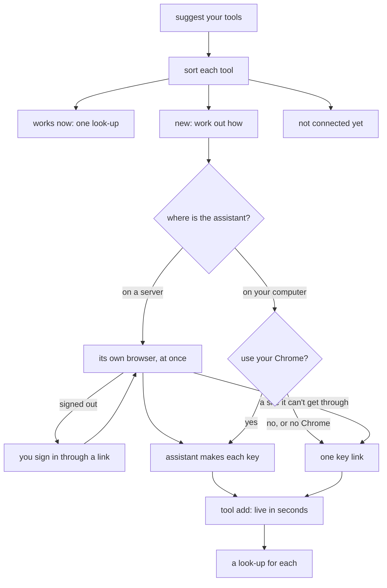

# Connect your tools

Connecting your tools lets your assistant use the services you work with, such as Stripe, Notion or Figma, through your company app. Setup starts it right after install. Later, say *connect my tools*, or name one tool: *connect my Figma*. The [`connect` skill](../../.agents/skills/connect/SKILL.md) follows this page.



## The three groups

Each tool goes in one group:

- **Works now.** The app can already use it. One look-up shows it working.
- **Waiting.** The app does not know it yet, its key is not saved, or you have no level for it. On the owner's computer, the helper adds it ([add a new tool](#add-a-new-tool-with-no-publish)). On a teammate's computer, it writes [a message for the owner](#a-teammates-computer).
- **Not connected yet.** A website with no API, a tool that offers only a sign-in, or your own mail, such as Gmail. You keep using it yourself. The helper signs in to no such site and sends no live view.

It ends with a short list:

```text
Your tools
  ✓ Stripe     works: 3 charges today
  … Notion     waiting for your key
  – Gmail      not connected yet: it needs a sign-in, which the app can't keep yet
```

After install, setup then offers a first app built on the tools that work ([getting started](getting-started.md#what-youll-end-up-with)). Later, the list is the whole answer.

## Sort each tool

1. **Suggest the tools they use.** With no tool named, read the person's page in `people/` and search memory: `node .claude/skills/memory/scripts/memory.mjs search <tool words>`, over what [setup learned from past chats](learning-from-chats.md). Say *You seem to use Stripe, Notion and Figma. Connect these?*, and let them confirm or change the list. With nothing known, ask which tools they use. When the person names one tool, handle that tool only, and ask about no other.
2. **Read the services list once:** `node scripts/company-api.mjs services --all --json` ([the services list](service-catalogue.md#list-the-services-you-can-use)). Match each tool to a row by name or id. When two rows could match, ask once.
3. **Find if this computer can store keys in the app.** It can when the primary worktree's `.env` holds `CLOUDFLARE_API_TOKEN`, as setup leaves it on the owner's computer. Any other computer takes [the teammate path](#a-teammates-computer).

| `services` says | Can store (owner) | Can't store (teammate) |
|---|---|---|
| Saved, you have a level | Works now: one look-up | Works now: one look-up |
| In the list, not saved, not in `app/worker/keys.ts` (added in a chat) | [A browser](#pick-the-browser) and `take-key`, else [the key link](#the-key-link) | Message: *save the key* |
| In the list, not saved, in `app/worker/keys.ts` | [The key link](#the-key-link), under its name in `app/.dev.vars.example`, with no code change | Message: *save the key* |
| Saved, you have no level | Does not happen: the owner holds every key | Message: *give me a level on Access* |
| No row | [Work out how](#work-out-how-to-add-a-new-tool), then [add it](#add-a-new-tool-with-no-publish) | Message: *connect <tool> for <name>* |
| No row, and no API at all | Not connected yet | Not connected yet |

Whether a tool has a public API comes from its own developer pages.

**A look-up** is one request that changes nothing: a read action, or a `GET` from the tool's [notes page](service-catalogue.md#notes-on-each-key-based-service) or its API guide, sent through `company-api.mjs` ([use a key directly](company-api.md#use-a-key-directly)). Show one short result, such as *3 charges today*. When you know no look-up, the line says only *ready*.

## Work out how to add a new tool

Most tools are new to the app, so this is the main step. For each tool with no row, start from its notes page, `wiki/services/<id>.md`, when one exists. Otherwise read the tool's own developer pages as plain pages. Pick the first way that fits:

| The tool offers | The app gets | Example |
|---|---|---|
| A fixed API key or personal access token | [A key used directly](company-api.md#use-a-key-directly): `forward`, `docs`, `lookups` | Stripe restricted key, Figma personal token |
| A remote MCP server that takes a fixed key | [An MCP server through the app](company-api.md#use-an-mcp-server-through-the-app): `forward.mcp`, with `reads` checked by hand | a server with a bearer key |
| Only a sign-in that renews (OAuth) | Nothing yet: *not connected yet: it needs a sign-in, which the app can't keep yet* | Google mail and calendar |

Write what you found on the tool's notes page: the kind of key, the page that makes it, the permissions, and one look-up. It goes in the next wiki save, like [any notes page](service-catalogue.md#notes-on-each-key-based-service). The next chat then reads it, and does not work it out again.

## Pick the browser

On the owner's computer, the assistant makes each new tool's key in a browser, through [`browser.mjs`](../../.agents/skills/connect/scripts/browser.mjs) only: never raw `agent-browser` or `browse.mjs`. Run `browser.mjs where` first. It connects to nothing and prints one line:

- `WHERE=server`: the assistant runs on a server with no screen. [Use the assistant's browser](#use-the-assistants-browser), with no question: the request to connect is the go-ahead.
- `WHERE=chrome`: the person's Chrome may be on this computer. Ask the [Chrome question](#use-your-own-chrome).
- `WHERE=link`: no browser can show here. Use [the key link](#the-key-link).

The key link is always the last way: for a tool the browser can not get through, or when the person picks it.

## Use the assistant's browser

On a server, the assistant makes each key in its own browser, Camoufox, and starts at once: no link, no question. It sends a private link, the [watch link](../development/watch-link.md), only when a tool asks the person to sign in, or when the person asks to watch. Sign-ins stay in that browser for the next time. While a link is open, the person can take over or hand back at any time. To stop, they say so in the chat.

1. **`attach --server`** prints `BROWSER=camoufox`. On `BROWSE_NEEDS=install`, ask once, by [the browser's install rule](../development/browsing.md).
2. **`open <key page>`** for the first tool. Only when the person asks to watch, run **`watch`**: it prints `HANDOVER_LINK`; send the link and go on.
3. **`read`**, then make the key, as in [your own Chrome](#use-your-own-chrome) steps 4 and 5. While a link is open, each command sets its line, such as *Clicking New integration…*.
4. **Signed out?** Run **`sign-in --tool <title>`** on the sign-in page. With no link open, it opens one and prints `HANDOVER_LINK`; then it prints `CONNECT_PAUSED=your-turn`. Run `hand-over.mjs wait` in the background and end the turn with the link. On `opened`, `wait` again. On `signed-in` or `handed-back`, `open` the key page again and `read`. Still a sign-in, a passkey, or a refusal: that tool takes the key link at the end.
5. **`done`** closes the page and any open link. The link says *All done. Go back to the chat.* When the person says *stop* in the chat, run `done --stopped`: the link says *Stopped*.

When `watch` or `sign-in` prints `HANDOVER_NEEDS=live-view`, or another chat's view is open, follow the [live view's rules](../development/live-view.md#when-it-opens).

Every command reads who holds the browser first:

- `CONNECT_PAUSED=taken-over`: the person tapped *Take over*. Run `wait` in the background, send the browser nothing, and end the turn. On `handed-back`, `read` the page again.
- `CONNECT_PAUSED=your-turn`: the person is signing in. Wait as in step 4.

## Use your own Chrome

On the owner's computer, the assistant can make each key in the person's own Chrome, where they are already signed in. It asks first:

```text
I can make their keys in your own Chrome,
in new tabs, while you watch. Each key
only reads.
Turn this on once: in Chrome, open
chrome://inspect/#remote-debugging and
switch it on. Chrome then asks "Allow?"
[ Use my Chrome ]  [ Send me the key link ]
```

On a yes, work only through [`browser.mjs`](../../.agents/skills/connect/scripts/browser.mjs), in your Chrome alone:

1. **`attach`.** When it prints `CHROME=none`, Chrome is on another computer or the switch is off. With `SERVER=possible` after it, go on in [the assistant's browser](#use-the-assistants-browser), with no second question; else use [the key link](#the-key-link) for every tool.
2. **`open <key page>`** for one tool. It opens a new tab. The script acts and reads only in tabs it opened, so your other tabs stay unread.
3. **Signed out?** Ask the person to sign in in that tab, and wait. Never type, save, or ask for a password or a sign-in code.
4. **Make the narrowest key that only reads**, with `read`, `click`, `fill`, `select` and `wait`. Make a key that can change things only when the person asks for it by name. `read` hides any key on the page as `[key …abcd]`, and `picture` refuses while a key shows.
5. **`take-key <ref> --tool <id>`** takes a new tool's key from the page. It saves `TOOL_<ID>` in the primary `app/.dev.vars` and on the live app, and prints only `TOOL_<ID> saved, ends in …abcd`. The chat shows only those last four characters. When a newer version of the app waits to go live, it says the key reaches the live app at the next publish instead. A key in the code has its own name, so it takes [the key link](#the-key-link), never `take-key`.
6. **`done`** closes the script's own tabs. It never closes Chrome.

A key page the assistant can not get through, such as a robot check or a layout it can not read, goes to one key link for all such tools at the end.

## The key link

When the person says no, `where` prints `WHERE=link`, or no browser got a tool's key, open one [key link](../development/secrets.md#receive-a-key-through-a-private-link) for all the tools. Each new tool's secret is `TOOL_<ID>`, the id upper-cased with `-` as `_`, and needs no line in `app/.dev.vars.example`. A key in the code takes its declared name. Give each a guide entry: `url`, `steps` and a harmless `check`, by [the token steps](../development/secrets.md#api-token-website-steps). Wait until it closes, then `npm run secrets:push`: a `TOOL_` key goes to the live app alone, never to previews. A tool whose key did not come says *waiting for your key*: *connect my Notion* later picks it up.

## Add a new tool with no publish

A new tool goes to the live app as app data, with no code change, no checks and no *publish it?*:

```bash
node scripts/company-api.mjs tool add stripe --file - <<'EOF'
{ "title": "Stripe", "purpose": "Payments and refunds", "docs": "https://docs.stripe.com/api",
  "forward": { "base": "https://api.stripe.com/v1/", "header": "Authorization", "prefix": "Bearer ",
    "lookups": ["POST search"] }, "levels": ["read"] }
EOF
```

`lookups` names only routes the guide says are read-only. `levels` is Read alone unless the person asks for changes too. A save off the live app is refused. The app sets the secret to `TOOL_<ID>`. It refuses a tool, naming the rule, with no purpose, a guide or address that is not HTTPS, the id of a key in the code, or a read that could match a path outside its address: the same rules as [a key used directly](company-api.md#use-a-key-directly). `tool remove <id>` takes one out. Only the owner or [an Admin](employee-access.md#admin) can add or remove one.

Then run each tool's look-up on the live app. The tool [shows in Access](api-keys.md#a-saved-key-shows-in-access) with *Added in a chat* and its reads. A preview holds no such tool. When an app is first built on one, that change [moves it into the code](company-api.md#use-a-key-directly).

## A teammate's computer

A teammate's computer can not store a key in the app. For each waiting tool, write one message they send to the owner. Name the owner from the company knowledge's people pages when you can, else write *the owner*:

```text
Send this to Matthew (owner):
  Hi Matthew, please connect Figma to the
  company app and give me Read on it in
  Access. Say "connect Figma for Ana" to
  your assistant.
```

Ask for no key in the chat, and keep no business key on that computer.

## Connect a tool for a teammate

When the owner says *connect Figma for Ana*, sort that one tool as above. Then end with the Access step: *Give Ana Read on Figma in Access: <your site>/apps/access/*. Only the owner or [an Admin](employee-access.md#admin) gives a [level](employee-access.md#key-levels). The assistant never changes Access.

Part of [the Cloudflare stack](README.md).
