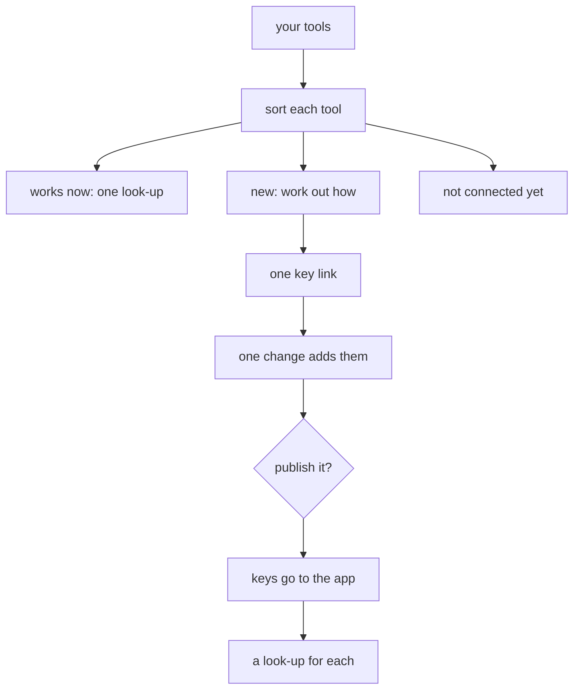

# Connect your tools

Connecting your tools lets your assistant use the services you work with, such as Stripe, Notion or Figma, through your company app. Setup starts it right after install. Later, say *connect my tools*, or name one tool: *connect my Figma*. The [`connect` skill](../../.agents/skills/connect/SKILL.md) follows this page.



## The three groups

Each tool goes in one group:

- **Works now.** The app can already use it. One look-up shows it working.
- **Waiting.** The app does not know it yet, its key is not saved, or you have no level for it. On the owner's computer, the helper adds it ([one key link, one yes](#one-key-link-one-change-one-yes)). On a teammate's computer, it writes [a message for the owner](#a-teammates-computer).
- **Not connected yet.** A website with no API, a tool that offers only a sign-in, or your own mail, such as Gmail. You keep using it yourself. While it connects, the helper opens no browser and sends no password link.

It ends with a short list:

```text
Your tools
  ✓ Stripe     works: 3 charges today
  … Notion     waiting for publish
  – Gmail      not connected yet: it needs a sign-in, which the app can't keep yet
```

After install, the next words are setup's last step: open your site and paste the *Make it yours* request ([getting started](getting-started.md#what-youll-end-up-with)). Later, the list is the whole answer.

## Sort each tool

1. **Ask which tools they use.** On the first run, ask for all of them. When the person names one tool, handle that tool only, and ask about no other.
2. **Read the services list once:** `node scripts/company-api.mjs services --all --json` ([the services list](service-catalogue.md#list-the-services-you-can-use)). Match each tool to a row by name or id. When two rows could match, ask once.
3. **Find if this computer can store keys in the app.** It can when the primary worktree's `.env` holds `CLOUDFLARE_API_TOKEN`, as setup leaves it on the owner's computer. Any other computer takes [the teammate path](#a-teammates-computer).

| `services` says | Can store (owner) | Can't store (teammate) |
|---|---|---|
| Saved, you have a level | Works now: one look-up | Works now: one look-up |
| In the list, not saved | [Key link](../development/secrets.md#receive-a-key-through-a-private-link), then `npm run secrets:push`, with no code change | Message: *save the key* |
| Saved, you have no level | Does not happen: the owner holds every key | Message: *give me a level on Access* |
| No row | [Work out how](#work-out-how-to-add-a-new-tool) | Message: *connect <tool> for <name>* |
| No row, and no API at all | Not connected yet | Not connected yet |

Whether a tool has a public API comes from its own developer pages.

**A look-up** is one request that changes nothing: a read action, or a `GET` from the tool's [notes page](service-catalogue.md#notes-on-each-key-based-service) or its API guide, sent through `company-api.mjs` ([use a key directly](company-api.md#use-a-key-directly)). Show one short result, such as *3 charges today*. When you know no look-up, the line says only *ready*.

## Work out how to add a new tool

Most tools are new to the app, so this is the main step. For each tool with no row, start from its notes page, `wiki/services/<id>.md`, when one exists. Otherwise read the tool's own developer pages, as plain pages, never in a signed-in browser. Pick the first way that fits:

| The tool offers | The app gets | Example |
|---|---|---|
| A fixed API key or personal access token | [A key used directly](company-api.md#use-a-key-directly): `forward`, `docs`, `lookups` | Stripe restricted key, Figma personal token |
| A remote MCP server that takes a fixed key | [An MCP server through the app](company-api.md#use-an-mcp-server-through-the-app): `forward.mcp`, with `reads` checked by hand | a server with a bearer key |
| Only a sign-in that renews (OAuth) | Nothing yet: *not connected yet: it needs a sign-in, which the app can't keep yet* | Google mail and calendar |

When the service lets you limit a key, ask for the narrowest read-only key that fits the person's work. Write what you found on the tool's notes page, in the same change: the kind of key, the page that makes it, the permissions, and one look-up. The next chat or install then reads it, and does not work it out again.

## One key link, one change, one yes

On the owner's computer, the owner's naming of the tools is the go: this page fixes the change's shape, so it gets no plan page ([just ask](../development/the-change-loop.md#just-ask)). Do these steps once for every new tool together:

1. **Record one change.** Do not run `/plan`. Record it yourself by [the OpenSpec CLI](../../.agents/skills/plan/references/openspec-cli.md): `openspec new change`, each artifact by `openspec instructions`, then `openspec validate`.
2. **Build it.** Add each tool's entry to [the key registry](../../app/worker/keys.ts): `forward`, `docs`, and `lookups` only from routes the guide documents as read-only, or `mcp`. Declare each secret in `app/.dev.vars.example`. Write the notes pages.
3. **Open one key link** for all of them, with a guide entry each: `url`, `steps` and a harmless `check` ([the key link](../development/secrets.md#receive-a-key-through-a-private-link)). The person makes each key in their own browser, by [the token steps](../development/secrets.md#api-token-website-steps). Wait until it closes. A tool whose key did not come stays in the change, and its line says *waiting for your key*: the next run sends only its link.
4. **Save it** with [`/save`](../../.agents/skills/save/SKILL.md). CI is [the gate](../development/the-change-loop.md#the-gate).
5. **Ask *publish it?* once**, naming the tools. On yes, `/ship`, then `npm run secrets:push`, then each tool's look-up on the live app. On no, the keys stay in `.env` on this computer, the change stays saved, and the list says *waiting for publish*. *Connect my tools* later picks it up.

Previews read only `app/.dev.vars.staging`, so the look-up runs on the live app after publish. A saved key then [shows in Access](api-keys.md#a-saved-key-shows-in-access).

## A teammate's computer

A teammate's computer can not store a key in the app. For each waiting tool, write one message they send to the owner. Name the owner from the company knowledge's people pages when you can, else write *the owner*:

```text
Send this to Matthew (owner):
  Hi Matthew, please connect Figma to the
  company app and give me Read on it in
  Access. Say "connect Figma for Ana" to
  your assistant.
```

Ask for no key in the chat, and keep no business key on that computer.

## Connect a tool for a teammate

When the owner says *connect Figma for Ana*, sort that one tool as above. Then end with the Access step: *Give Ana Read on Figma in Access: <your site>/apps/access/*. Only the owner or [an Admin](employee-access.md#admin) gives a [level](employee-access.md#key-levels). The assistant never changes Access.

Part of [the Cloudflare stack](README.md).
