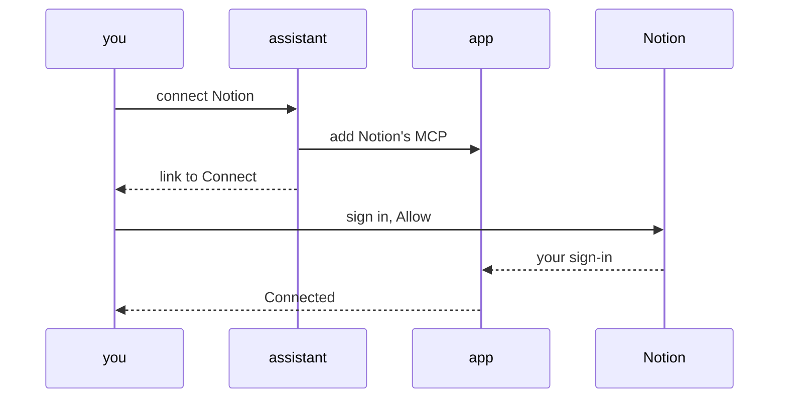

# MCP connections

An MCP connection lets a chat use a service's own tools, such as Canva's or Notion's, through the app, with each person signed in to it once, as themselves. The app holds and renews every sign-in, so no computer or chat ever holds one. A chat finds MCP tools in [the services list](service-catalogue.md) beside the app's own actions.



## Add an MCP

Anyone signed in can add one, three ways:

- **On the page.** *+ Add* in [Access's Services view](access-screens.md#the-services-view): the MCP's address and a name.
- **From the chat.** Say *connect Notion*. The assistant finds the service's MCP address on its own help pages, never guessing one, then runs `node scripts/company-api.mjs mcp add <address> [--name <name>]`. It prints the result and the link to [Connect](#connect-your-own-sign-in), which the assistant sends you.
- **From Claude or Codex**, by [bringing them in](#bring-in-mcps-from-claude-or-codex).

The address must be HTTPS and offer a sign-in the app can use with no setup at the service: one the app registers itself for. Otherwise nothing is saved and the reason is plain, such as *That address has no sign-in we can use.* The same address twice is refused, and an app holds at most 50 MCPs. Not covered yet: an MCP that signs in with a fixed key, one that needs an app made on the service's developer site, and an MCP's prompts or files, as only its tools are used.

## Bring in MCPs from Claude or Codex

Ask *bring in my MCPs* and the assistant runs `node scripts/company-api.mjs mcp import`. It reads this computer's Claude and Codex settings for names and addresses only: `~/.claude.json` (yours and this project's), the project's `.mcp.json`, and `~/.codex/config.toml` (or under `$CODEX_HOME`). It never opens a sign-in file: a sign-in belongs to the app that got it, so each MCP still needs Connect in this app.

It skips, naming the reason:

- one that runs on this computer;
- one that uses a fixed key, without reading the key;
- one that uses an older connection the app doesn't speak;
- one already added, or not at an HTTPS address.

It prints the offer, such as *Found Canva and Linear in Claude, and Notion in Codex. Add them?*, and the chat asks you. With `--yes` it adds each one under your login and prints each Connect link.

Once your Connect succeeds, the assistant offers to take the MCP out of Claude or Codex, so its tools stop loading into every chat there. `mcp import --remove-local <name>` prints the exact command, `claude mcp remove <name> -s <scope>` or `codex mcp remove <name>`, and runs it with `--yes` only after you agree. It never edits either settings file itself. An entry in the project's `.mcp.json` is shared with the team, so it is a file edit for the normal save.

## Connect your own sign-in

Each person connects their own account, once per MCP. Your chat then uses the MCP as you: it sees only what your account there can see, and acts under your name.

1. **Open the link** a chat sends, `/apps/access/services/<id>`. Services opens on that MCP with its Connect ready; `?connect=1` on the link starts Connect at once.
2. **Press Connect** and sign in at the service, in your own browser.
3. **Come back to *Connected***, with your account there and the date.

A sign-in return counts only once, within 10 minutes of Connect, and only for the person who pressed it. Otherwise Services says it expired, was someone else's, or was refused: press Connect again.

A chat with no sign-in to use, its person's own or [a shared one](#share-your-sign-in-with-the-team), sends nothing to the service: it answers `mcp_not_connected` with the link, and the chat sends it to the person. *Disconnect* deletes your own sign-in and your share. Nobody can disconnect someone else.

## Share your sign-in with the team

On your own connection, tick *Let the team use my sign-in* and pick:

- ***Look-ups only*** (the default): a teammate's chat can find and read, but not post, edit or delete under your name.
- ***Everything***: a teammate's chat can run every tool.

A teammate with no sign-in of their own then uses yours, and their chat says whose it used. Their own sign-in always comes first.

```text
whose sign-in        │ look-up tools │ other tools
─────────────────────┼───────────────┼────────────
your own             │ yes           │ yes
shared, look-ups only│ yes           │ refused
shared, everything   │ yes           │ yes
none                 │ connect first │ connect first
```

*Look-ups only* allows only the tools the MCP marks as look-ups, in the tool list the app saved. Every other tool, including one missing from that list, is refused with `mcp_share_read_only`, naming the sharer, and the link to connect your own. An MCP that marks no tool as a look-up can't be used this way: share *Everything*, or each teammate connects their own.

One shared sign-in per MCP at a time, so whose account a call uses is never in doubt. While Kim shares, your box says *kim@example.com is sharing theirs.* Sharing stops at once when the sharer unticks it, disconnects, needs a new sign-in, or [is removed from Access](employee-access.md#key-levels), and when the MCP is removed. The owner or an Admin can stop anyone's sharing.

## Who can add and remove

| Who | Add | Remove |
|---|---|---|
| Anyone signed in | yes | no |
| The person who added it | yes | while nobody else is connected |
| The owner or an Admin | yes | any MCP |

Removing an MCP deletes everyone's sign-in for it, and can't be undone. The person who added it, with others connected, is told to ask the owner or an Admin.

**MCPs take no Access level.** Each person's own account at the service decides what their sign-in can do, and a sharer decides what theirs allows. [Key levels](employee-access.md#key-levels) govern keys alone.

## Renewal and *Needs a new sign-in*

The app renews each sign-in before it ends, with nobody signing in again. Calls at the same moment renew it once, so a service that replaces the old sign-in on renewal never signs you out.

When the service ends a sign-in, that person's row says *Needs a new sign-in*, and their calls answer `mcp_reconnect` with the link: press Connect again. Until then their own calls use a share, if one exists, and say so. A teammate leaning on that sign-in's share is told to connect their own.

## Calls and their record

A call runs a tool once through the app: `call mcp.<id>.<tool>`, as for [any action](company-api.md#connect-and-call).

- **It goes only to the MCP's own address**, with no redirect followed, and waits up to 60 seconds. A change that times out answers that its outcome is unknown and is not sent again: check before you repeat it.
- **An answer holding the sign-in it was sent is refused.**
- **Each call is recorded** with who made it, whose sign-in it used, the MCP, the tool, and whether it was a look-up; never its inputs or answer.

The app keeps one saved copy of each MCP's tool list, the same for everyone. It refreshes on the MCP's first Connect, on a call naming a tool the copy lacks, and on *Refresh*; a search never contacts the MCP.

## What is stored and sealed

The app's database keeps each MCP's address, name and sign-in details, its tool list, and one row per person: their sealed sign-in, account name, date, state and share choice. A sign-in in progress is kept for 10 minutes.

Every stored sign-in, and any secret the service gave the app, is sealed with `WONG_MCP_SEAL`, a Worker secret setup and the update make: random, never shown, and not an Access key. Only the app's MCP code reads it; every other route is handed none. So a mini app that reads the shared database by mistake gets nothing usable. Like [handing out only listed keys](company-api.md#list-the-keys-a-route-uses), this stops mistakes, not code written to get around it: handlers share one Worker.

Until the seal exists, Services says connecting MCPs needs one more step from the owner: ask the assistant to run the update. If the seal is lost or replaced, stored sign-ins can't be opened: each row says *Needs a new sign-in*, and one Connect fixes it.

## Each copy of the app connects on its own

The live app, staging and each preview keep their own MCP list. The service registers each copy's return address apart, so each person signs in again on each copy. That is fine for testing a preview.

Part of [the Cloudflare stack](README.md).
